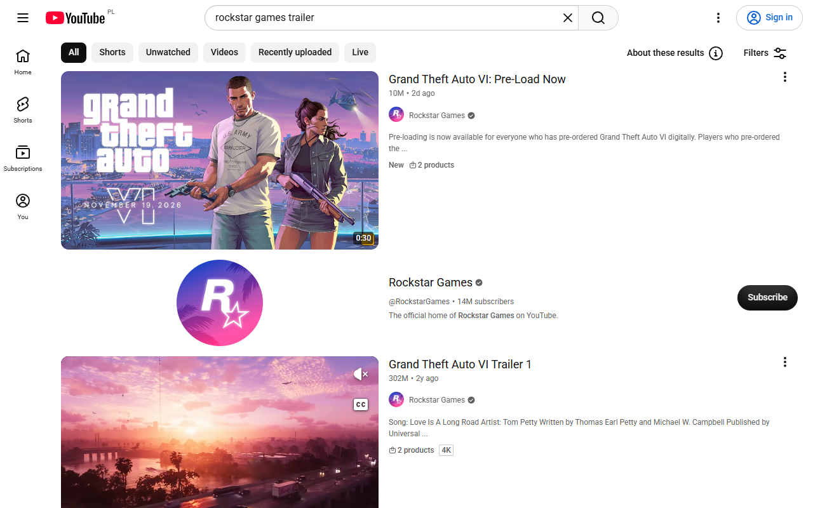
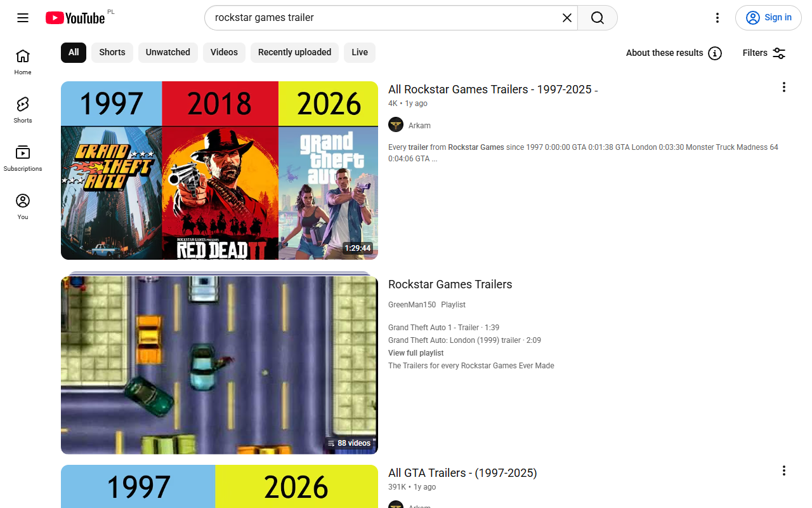
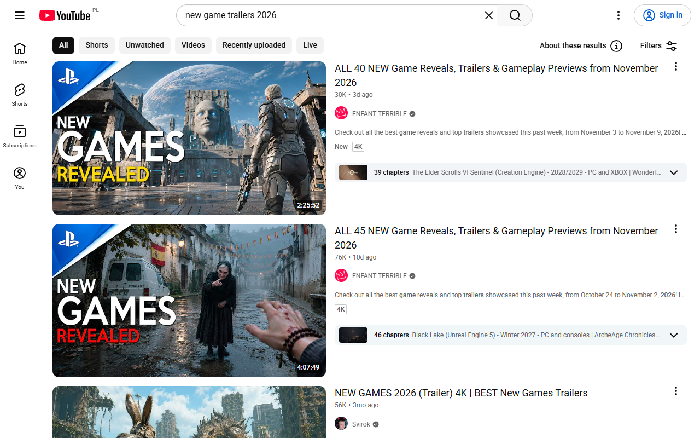

<div align="center">


<a href="https://github.com/kpulka247/gta6-spoiler-blocker/actions" title="GitHub Actions Workflow Status"></a>
<a href="https://github.com/kpulka247/gta6-spoiler-blocker/releases" title="GitHub Release"></a>
<a href="https://github.com/kpulka247/gta6-spoiler-blocker/blob/main/LICENSE" title="GitHub License"></a>

</div>

## Overview

GTA 6 Spoiler Blocker is a browser extension for people who want to play Grand Theft Auto VI knowing nothing about it. Once the game is out, its story, characters, and ending will be on every feed, search page, and news site. Muting a few keywords on one social network does not stop that.

The extension reads every page you open and blurs anything about GTA VI before you see it: video tiles, posts, comments, search results, article cards, and image captions. The page keeps its layout, and you click a blurred card to see it. If you prefer, it removes them from the page instead. Pages that are entirely about the game, such as a trailer or a review, are covered with a see-through blur and a short message.

It is on from the moment you install it, in every language. There is nothing to configure.

## Features

- 🌫️ **Blurs in place, or removes.** A matching card stays where it is, blurred, with a small label. One click shows it, and the click does not open the link underneath. Switch to **Remove** in the popup to take spoilers out of the page completely.
- 🏷️ **Says what it found.** A pink dot and **GTA VI spoiler** mark a card that names GTA VI, its characters, or its places. A teal dot and **GTA or Rockstar post** mark a card that strict mode caught because it only mentions GTA or Rockstar.
- 🛡️ **Catches every spelling.** `GTA 6`, `GTA VI`, `gta6`, `#GTA6`, `GTA-VI`, `Grand Theft Auto: VI`, `ГТА 6`, `グラセフ6`, `侠盗猎车手6`, `그랜드 테프트 오토 6`, `जीटीए 6`, and more. Fullwidth digits, Roman numeral characters, and hidden zero-width characters do not get past it. The main characters, the places of Leonida, and phrases like "Jason dies" are blocked in several languages.
- 🎯 **Strict mode, on by default.** Many posts hide GTA VI behind a **See more** link or inside an image, with only "All GTA helicopters" or a group called "Rockstar Games" in plain view. Strict mode also blurs posts that mention GTA, Grand Theft Auto, or Rockstar Games. Turn it off in the popup if you want older GTA content to stay clear.
- 📖 **Reads Facebook posts in full.** Facebook cuts long posts off behind **See more**, and the GTA VI part is often after the cut. The extension clicks **See more** on each post, so the full text is checked before you read it.
- 🌅 **Covers pages that are about the game.** If the address or the tab title mentions GTA VI, the page is blurred behind a card with **Take me back** and **Show anyway**. Videos and audio on the page are paused, and the tab is renamed.
- 🎬 **Treats Rockstar's own channels as spoilers.** The Rockstar Games website, YouTube channel, X, Instagram, Facebook, Threads, TikTok, and Twitch accounts are covered, and any post that links to them is blurred.
- 🧱 **Blurs whole cards.** It has card rules for YouTube, Reddit, X, Facebook, Instagram, TikTok, Twitch, Google, Bing, DuckDuckGo, and Steam, so a thumbnail is blurred together with its title. On other sites it blurs the nearest card, list item, or paragraph.
- 🌍 **Speaks 20 languages.** The popup, labels, and page cover follow your browser language: English, Polish, German, Spanish, French, Italian, Portuguese, Dutch, Swedish, Czech, Russian, Ukrainian, Turkish, Arabic, Hindi, Indonesian, Japanese, Korean, and Simplified and Traditional Chinese.
- 🔢 **Shows a count on the icon.** The badge shows how many spoilers are blurred on the current page.
- 🔒 **Collects no data.** Everything runs on your device. There are no servers, no analytics, and no remote block lists.

## Screenshots

A YouTube search for `rockstar games trailer` without the extension:



The same search with the extension:



Remove mode on a search for `new game trailers 2026`. Other games stay, and GTA VI is gone:



A page about GTA VI:


The popup:


## Installation

The Chrome Web Store and Firefox Add-ons listings are in review. Until they are live, install the latest build from [GitHub Releases](https://github.com/kpulka247/gta6-spoiler-blocker/releases):

- **Chrome, Edge, Brave, or Opera.** Download `gta6spoilerblocker-<version>-chrome.zip` and unzip it. Open `chrome://extensions`, turn on **Developer mode**, click **Load unpacked**, and select the unzipped folder.
- **Firefox.** Download `gta6spoilerblocker-<version>-firefox.zip`. Open `about:debugging#/runtime/this-firefox`, click **Load Temporary Add-on**, and select the zip.

## Usage

Install it and browse. The extension is on by default on every site.

To see a blurred card, click it. To open the link inside it, click again.

Click the toolbar icon to open the popup:

- **Protection** turns blocking on or off everywhere.
- **Spoilers** chooses **Blur** or **Remove**.
- **Strict mode** also blurs posts that mention GTA or Rockstar without naming GTA VI.
- **Block on this site** turns blocking off for the current site only. Use it if you write about GTA VI or moderate a GTA community.

To report a spoiler that got through, [open an issue](https://github.com/kpulka247/gta6-spoiler-blocker/issues) with the page address. Leave the spoiler itself out of the issue.

## Known limitations

- **Images with no text.** The extension reads text, links, and image descriptions. A thumbnail that shows GTA VI art under a title that never mentions GTA stays clear. Strict mode catches most of these, because such posts usually name GTA or Rockstar somewhere.
- **Facebook posts open up.** Because the extension clicks **See more**, every Facebook post in your feed shows its full text.
- **Strict mode is broad.** It blurs GTA V and GTA Online posts, and any "GTA" that means the Greater Toronto Area. Click to show them, or turn strict mode off.
- **Vice City.** The extension treats "Vice City" as a GTA VI location. Pages about Grand Theft Auto: Vice City from 2002 are blurred too.
- **Site layouts change.** The card rules for each site match its current markup. When a site redesigns, a rule can stop matching. The fallback still blurs the nearest list item or paragraph, but a thumbnail can stay clear until the rule is updated.
- **Shadow DOM.** The extension does not check text inside shadow roots.

## Development and build

This project uses Node.js for its build system, Conventional Commits, and `semantic-release` for automated versioning, packaging, and publishing.

### 🚀 Getting started

You need:

- [Node.js](https://nodejs.org) (LTS)
- [pnpm](https://pnpm.io/) (`npm install -g pnpm`)
- [Git](https://git-scm.com/)

Install dependencies:

```bash
pnpm install
```

### 🔧 Build the extension

```bash
# Production build for Chrome and Firefox (minified, with ZIPs)
pnpm build

# Development build that rebuilds on every change (source maps, no ZIPs)
pnpm dev
```

Webpack writes unpacked builds to `dist/gta6spoilerblocker-chrome/` and `dist/gta6spoilerblocker-firefox/`. A production build also writes `dist/gta6spoilerblocker-<version>-chrome.zip` and `dist/gta6spoilerblocker-<version>-firefox.zip`.

### 🧪 Test

```bash
# Unit tests: every spoiler that must be caught, every phrase that must not, and every translation
pnpm test

# End-to-end tests: loads the built extension into Chromium and checks real pages
pnpm test:e2e

# Mozilla's linter on the Firefox build
pnpm lint:firefox
```

Before the first `pnpm test:e2e`, download the test browser with `pnpm exec playwright install chromium`.

To try the extension by hand, run `pnpm dev`, open `chrome://extensions`, turn on **Developer mode**, click **Load unpacked**, and select `dist/gta6spoilerblocker-chrome/`.

### 🏷️ Versioning and releases

Every merge to `main` runs [semantic-release](https://github.com/semantic-release/semantic-release) in GitHub Actions. It reads the [Conventional Commits](https://www.conventionalcommits.org/) since the last release, then:

1. Picks the next version (`fix:` is a patch, `feat:` is a minor, `BREAKING CHANGE:` is a major).
2. Updates `package.json` and `CHANGELOG.md` and commits them.
3. Builds both browsers. The build copies the version from `package.json` into each manifest.
4. Creates a Git tag and a GitHub Release with both ZIPs attached.
5. Uploads the Chrome build to the Chrome Web Store.
6. Signs and uploads the Firefox build to Firefox Add-ons.

You do not bump versions by hand. To connect the stores the first time, follow [docs/publishing.md](docs/publishing.md).

## How it works

| File                             | Owns                                                                                                                                                                                                                                                        |
| -------------------------------- | ----------------------------------------------------------------------------------------------------------------------------------------------------------------------------------------------------------------------------------------------------------- |
| `src/spoilers.js`                | What counts as a spoiler. `EXPLICIT_TERMS` lists the title in every script, the characters, the places, and death phrases. `FRANCHISE_TERMS` lists the broader terms that strict mode adds. `mentionsGta6()` and `urlMentionsGta6()` are the only matchers. |
| `src/sites.js`                   | Where a self-contained card starts and ends on each supported site, the fallback for every other site, the shelves that collapse when remove mode empties them, and the **See more** buttons to click.                                                      |
| `src/settings.js`                | The stored settings (`enabled`, `strict`, `style`, `allowedSites`) and their defaults.                                                                                                                                                                      |
| `src/locales.js`                 | Every user-facing string in every language. The build turns it into `_locales/*/messages.json`.                                                                                                                                                             |
| `src/styles/tokens.css`          | The colors and font shared by the blur labels, the page cover, and the popup.                                                                                                                                                                               |
| `src/content/blocker.js`         | Walks the page, checks text and attributes, and blurs or reveals cards.                                                                                                                                                                                     |
| `src/content/shield.js`          | The page cover.                                                                                                                                                                                                                                             |
| `src/content/index.js`           | Starts the blocker, watches the page for changes, handles click-to-reveal, and decides when to cover the page.                                                                                                                                              |
| `src/background.js`              | The toolbar badge, and protecting tabs that were open at install time.                                                                                                                                                                                      |
| `public/manifest.json`           | The shared manifest. `webpack.config.js` adds the Chrome or Firefox background and the Firefox ID at build time.                                                                                                                                            |
| `scripts/build-icons.js`         | Renders the icons, store icon, README banner, and promo tiles from `src/assets/logo.svg`. Run it with `pnpm icons`.                                                                                                                                         |
| `scripts/capture-screenshots.js` | Loads the extension into Chromium, opens YouTube, and writes the README screenshots and the framed store screenshots. Run it with `pnpm screenshots`.                                                                                                       |

To block a new term, add it to `EXPLICIT_TERMS` or `FRANCHISE_TERMS` in `src/spoilers.js` and add an example to `test/unit/spoilers.test.js`.

To add a language, add a block to `MESSAGES` in `src/locales.js`. `pnpm test` fails until the block has every key and its store description fits in 132 characters.

## Contributing

Contributions are welcome. 💖 New terms, translations, site support, and false-positive reports help the most.

Read **[CONTRIBUTING.md](./CONTRIBUTING.md)** to set up the project, find the target branch (`dev`), and name your Pull Request.

## Disclaimer

This is an unofficial fan project. It is not affiliated with, endorsed by, or sponsored by Rockstar Games or Take-Two Interactive. Grand Theft Auto is a trademark of Take-Two Interactive Software, Inc.

## Changelog

Each release is documented in [CHANGELOG.md](./CHANGELOG.md).
