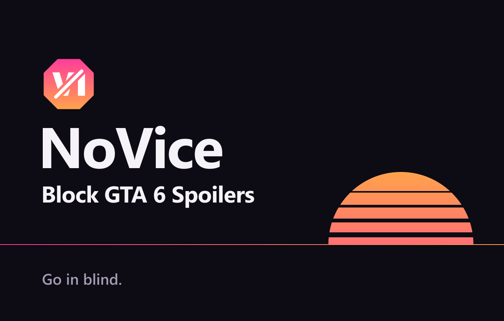
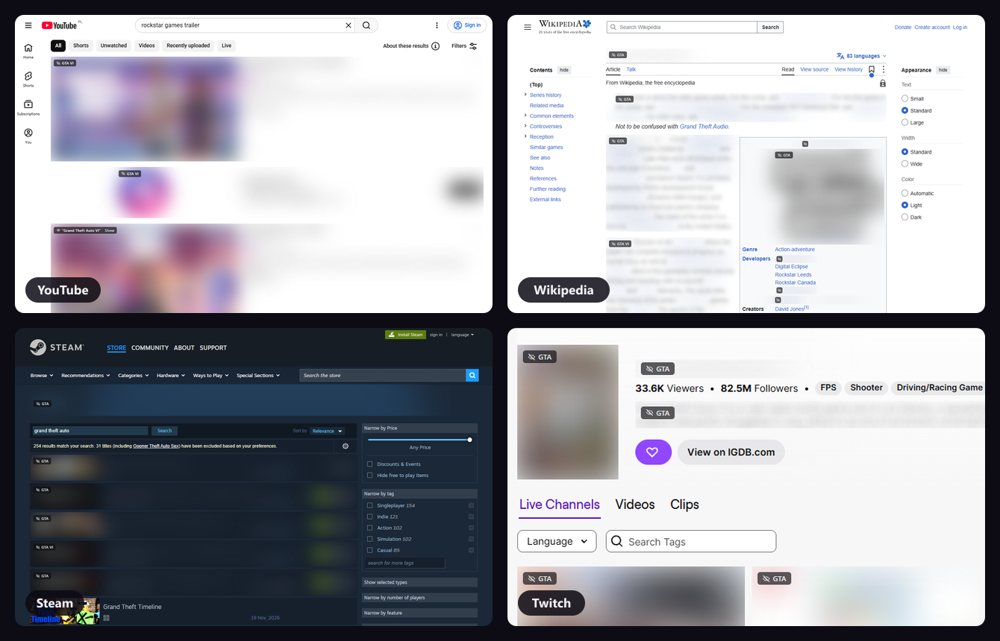
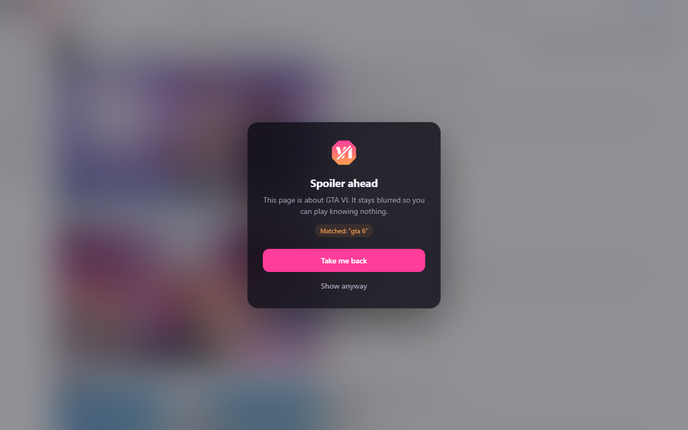
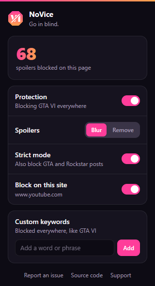

<div align="center">



<a href="https://github.com/kpulka247/novice/actions" title="GitHub Actions Workflow Status"></a>
<a title="Chrome Web Store Size"></a>
<a href="https://github.com/kpulka247/novice/releases" title="GitHub Release"></a>
<a href="https://github.com/kpulka247/novice/blob/main/LICENSE" title="License"></a>

<a href="https://chromewebstore.google.com/detail/novice-block-gta-6-spoile/caledcpfdapmmhmflbpjmjnenmjggghp" title="Chrome Web Store Users"></a>
<a href="https://chromewebstore.google.com/detail/novice-block-gta-6-spoile/caledcpfdapmmhmflbpjmjnenmjggghp" title="Chrome Web Store Rating"></a>
&nbsp;&nbsp;&nbsp;&nbsp;&nbsp;&nbsp;
<a href="https://addons.mozilla.org/firefox/addon/novice/" title="Mozilla Add-on Users"></a>
<a href="https://addons.mozilla.org/firefox/addon/novice/" title="Mozilla Add-on Rating"></a>

</div>

## Overview

Play GTA VI knowing nothing about it. NoVice blurs every trailer, leak, post, and story spoiler about Grand Theft Auto VI on every website you visit, and leaves the rest of the internet alone. It is on from the moment you install it.



## Features

- 🌫️ **Blur or remove.** Spoilers blur in place with a small tag. Hover to see which words matched, click to see the post, or switch to removing them.
- 🧠 **Knows the game.** Every spelling of the title in every script, the characters, the places of Leonida, and Rockstar's own channels.
- 🎯 **Strict mode.** Also catches GTA and Rockstar posts, insiders, leakers, GTA creators and roleplay servers from many countries, and posts that hide GTA VI behind "See more".
- ✍️ **Your own keywords.** Add any word or phrase, and it is blocked everywhere, like GTA VI.
- 🌅 **Covers whole pages.** Trailers, reviews, and wikis about GTA VI get a see-through cover.
- 🌍 **20 languages.** The popup and labels follow your browser language.
- 🔒 **Private.** Everything runs on your device. No data leaves it.

## Screenshots

<div align="center">

&nbsp;

</div>

## Installation

<div align="center">

<a href="https://chromewebstore.google.com/detail/novice-block-gta-6-spoile/caledcpfdapmmhmflbpjmjnenmjggghp" title="Chrome Web Store Version"></a>
<a href="https://addons.mozilla.org/firefox/addon/novice/" title="Mozilla Add-on Version"></a>

</div>

Click your browser's store and add the extension. For 🦁 Brave, 🔴 Opera, or 🌀 Microsoft Edge, use the Chrome Web Store.

## Usage

Browse as usual. Hover a blurred card to see which words matched, and click it to see the card. Click the toolbar icon to switch between blur and remove, turn strict mode off, add your own keywords, or turn the extension off for one site.

Found a spoiler that got through? [Open an issue](https://github.com/kpulka247/novice/issues) with the page address, but leave the spoiler itself out.

<details>
<summary>Known limitations</summary>

- The extension reads text, links, and image descriptions. An image whose page never mentions GTA stays clear.
- Strict mode also blurs GTA V and GTA Online posts, and everything from GTA creators and roleplay servers. Click to see them, or turn strict mode off.

- "Vice City" counts as a GTA VI place, so pages about GTA: Vice City (2002) are blurred too.
- Facebook posts open in full, because the extension clicks **See more** to check the hidden text.

</details>

## Development & Build

You need [Node.js](https://nodejs.org) (LTS), [pnpm](https://pnpm.io/), and [Git](https://git-scm.com/).

```bash
pnpm install     # install dependencies
pnpm dev         # build both browsers and rebuild on every change
pnpm build       # production build with ZIPs in dist/
pnpm test        # matcher and translation tests
pnpm test:e2e    # loads the extension into Chromium and checks real pages
```

To try it, open `chrome://extensions`, turn on **Developer mode**, click **Load unpacked**, and select `dist/novice-chrome/`.

Every merge to `main` is released automatically with [semantic-release](https://github.com/semantic-release/semantic-release): a new version, a changelog entry, a GitHub Release, and uploads to both stores. [docs/publishing.md](docs/publishing.md) explains the setup.

## Contributing

> **Contributions are highly welcome!** 💖 New terms, translations, site support, and false-positive reports help the most.

Read **[CONTRIBUTING.md](./CONTRIBUTING.md)** for the project layout, the target branch (`dev`), and the Pull Request naming rules.

## License

Source-available, all rights reserved. You can read the code, fork it, and send pull requests. You cannot publish the extension or a modified copy of it in any store or elsewhere. See [LICENSE](./LICENSE).

An unofficial fan project, not affiliated with Rockstar Games or Take-Two Interactive. Grand Theft Auto is a trademark of Take-Two Interactive Software, Inc.

## Changelog

Changes for each release are in [CHANGELOG.md](./CHANGELOG.md).
